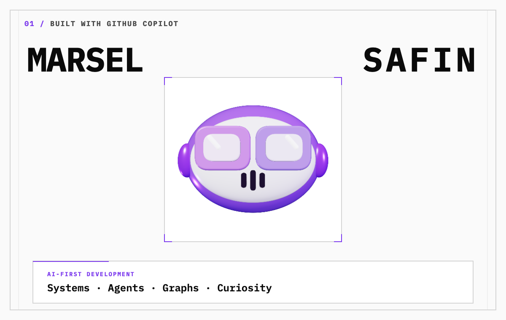
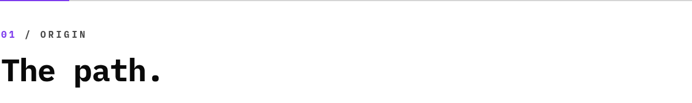
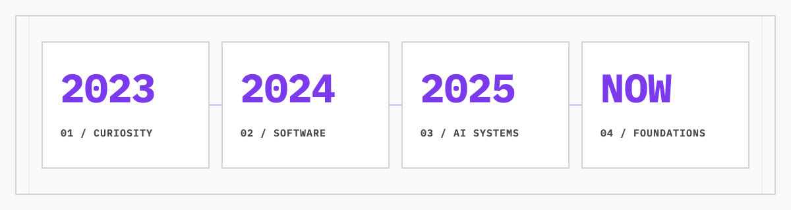
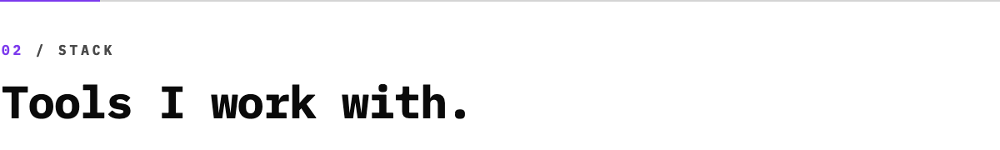
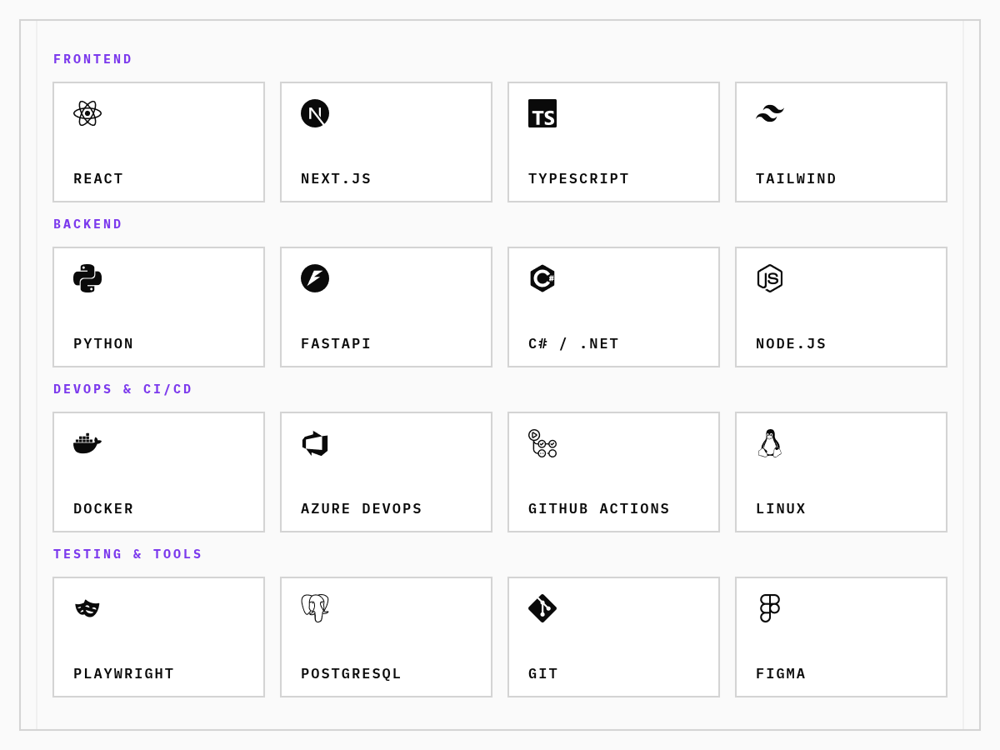
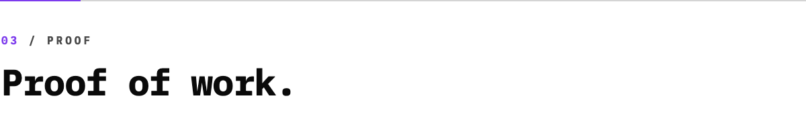
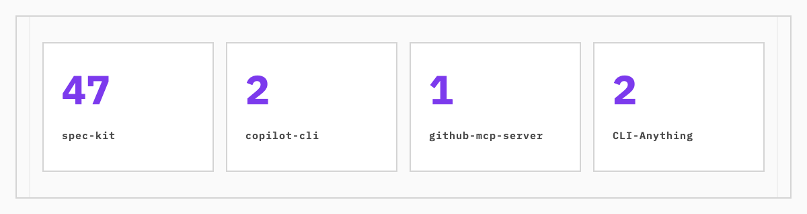
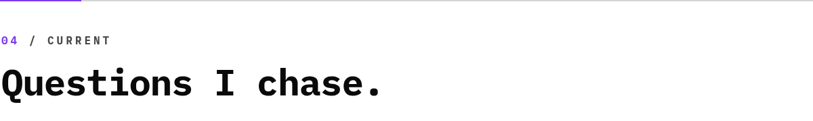
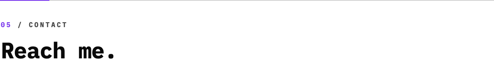

<picture>
  <source media="(max-width: 600px) and (prefers-color-scheme: dark)" srcset="./assets/hero-mobile-dark.png">
  <source media="(max-width: 600px) and (prefers-color-scheme: light)" srcset="./assets/hero-mobile-light.png">
  <source media="(prefers-color-scheme: dark)" srcset="./assets/hero-dark.webp">
  <source media="(prefers-color-scheme: light)" srcset="./assets/hero-light.webp">
  
</picture>

<h1>Marsel Safin — AI-first developer</h1>

<strong>PhD in breaking things apart until I understand how they work.</strong>

Curiosity brought me into technology. AI became how I build.

I keep pulling systems apart until I understand enough to build with them.

<strong><a href="#user-content-the-path">Explore the origin story →</a></strong>

<picture>
  <source media="(prefers-color-scheme: dark)" srcset="./assets/banner-origin-dark.png">
  <source media="(prefers-color-scheme: light)" srcset="./assets/banner-origin-light.png">
  
</picture>
<picture>
  <source media="(max-width: 600px) and (prefers-color-scheme: dark)" srcset="./assets/timeline-mobile-dark.png">
  <source media="(max-width: 600px) and (prefers-color-scheme: light)" srcset="./assets/timeline-mobile-light.png">
  <source media="(prefers-color-scheme: dark)" srcset="./assets/timeline-dark.png">
  <source media="(prefers-color-scheme: light)" srcset="./assets/timeline-light.png">
  
</picture>

<strong>LATE 2023 / CURIOSITY</strong>

<h3>I wanted to understand how machines are built.</h3>

When ChatGPT 3.5 arrived, technology became something I could question, provoke, and take apart.

I learned by experimenting, pushing limits, breaking assumptions, and tracing what happened next.

That loop turned curiosity into a direction.

<strong>2024 / EDUCATION</strong>

<h3>Frontend became my entry into software.</h3>

I started a 400 YH-point Front End Developer program and gained a structured view of JavaScript, APIs, testing, UX, accessibility, agile work, and delivery.

<strong>2025 / AI-FIRST DEVELOPMENT</strong>

<h3>Using AI became AI-first development.</h3>

I moved from prompting tools to building systems through them.

My work expanded into agent orchestration, custom harnesses, AI memory, token optimization, and specialized AI-native SaaS products.

I also began running open-weight models in Google Colab with access to approximately 40 GB of VRAM and contributing to open-source projects.

<strong>NOW / GRAPHS / CONTEXT / ML</strong>

<h3>I am following the systems underneath the tools.</h3>

My current focus is graph engineering, context engineering, and machine-learning foundations.

<picture>
  <source media="(prefers-color-scheme: dark)" srcset="./assets/banner-stack-dark.png">
  <source media="(prefers-color-scheme: light)" srcset="./assets/banner-stack-light.png">
  
</picture>
<picture>
  <source media="(max-width: 600px) and (prefers-color-scheme: dark)" srcset="./assets/stack-mobile-dark.png">
  <source media="(max-width: 600px) and (prefers-color-scheme: light)" srcset="./assets/stack-mobile-light.png">
  <source media="(prefers-color-scheme: dark)" srcset="./assets/stack-dark.png">
  <source media="(prefers-color-scheme: light)" srcset="./assets/stack-light.png">
  
</picture>

<picture>
  <source media="(prefers-color-scheme: dark)" srcset="./assets/banner-proof-dark.png">
  <source media="(prefers-color-scheme: light)" srcset="./assets/banner-proof-light.png">
  
</picture>
<h3>Front End Developer</h3>

<strong>400&nbsp;YH-poäng / EDUCATION / FOUNDATIONS</strong>

JavaScript and frameworks · API development · Software testing · UX and accessibility · Agile project work · 26 weeks of LIA · AI, tools, and sustainable code

<h3>How I build</h3>

<strong>FRAME / BUILD / REFINE</strong>

AI is not an add-on to my workflow. It is the environment I build through.

Problem definition · Product direction · Agent direction · Debugging · Model and tool selection · Deployment · UX

<h3>Open source contributions</h3>
<picture>
  <source media="(prefers-color-scheme: dark)" srcset="./assets/opensource-dark.png">
  <source media="(prefers-color-scheme: light)" srcset="./assets/opensource-light.png">
  
</picture>

<strong><a href="https://github.com/github/spec-kit">github/spec-kit</a></strong> — 47 merged PRs

<strong><a href="https://github.com/github/copilot-cli">github/copilot-cli</a></strong> — 2 merged PRs

<strong><a href="https://github.com/github/github-mcp-server">github/github-mcp-server</a></strong> — 1 merged PR

<strong><a href="https://github.com/HKUDS/CLI-Anything">HKUDS/CLI-Anything</a></strong> — 2 merged PRs

<picture>
  <source media="(prefers-color-scheme: dark)" srcset="./assets/banner-current-dark.png">
  <source media="(prefers-color-scheme: light)" srcset="./assets/banner-current-light.png">
  
</picture>
<h3>Currently exploring</h3>

<strong>NEAR TERM / TECHNICAL DEPTH</strong>

Graph engineering · Context engineering · ML foundations

<h3>Long-term questions</h3>

<strong>LONG TERM / MEANINGFUL SYSTEMS</strong>

Robotics · Medicine · Biology — and what AI could contribute there.

<picture>
  <source media="(prefers-color-scheme: dark)" srcset="./assets/banner-contact-dark.png">
  <source media="(prefers-color-scheme: light)" srcset="./assets/banner-contact-light.png">
  
</picture>

<strong><a href="https://github.com/marcelsafin">GitHub</a> · <a href="https://www.linkedin.com/in/marcelsafin/">LinkedIn</a> · <a href="mailto:marsel@mynextcode.se">Email</a></strong>

